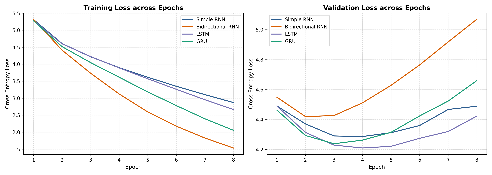
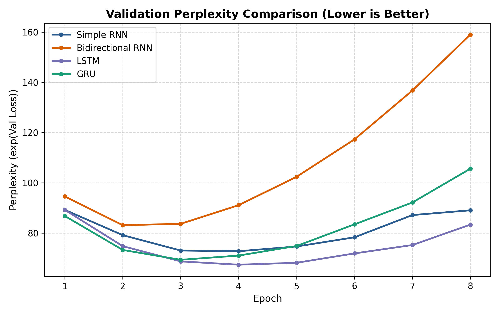
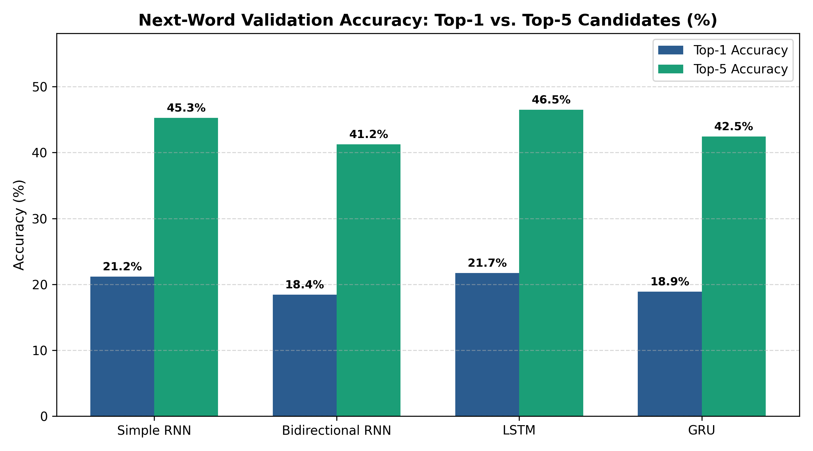
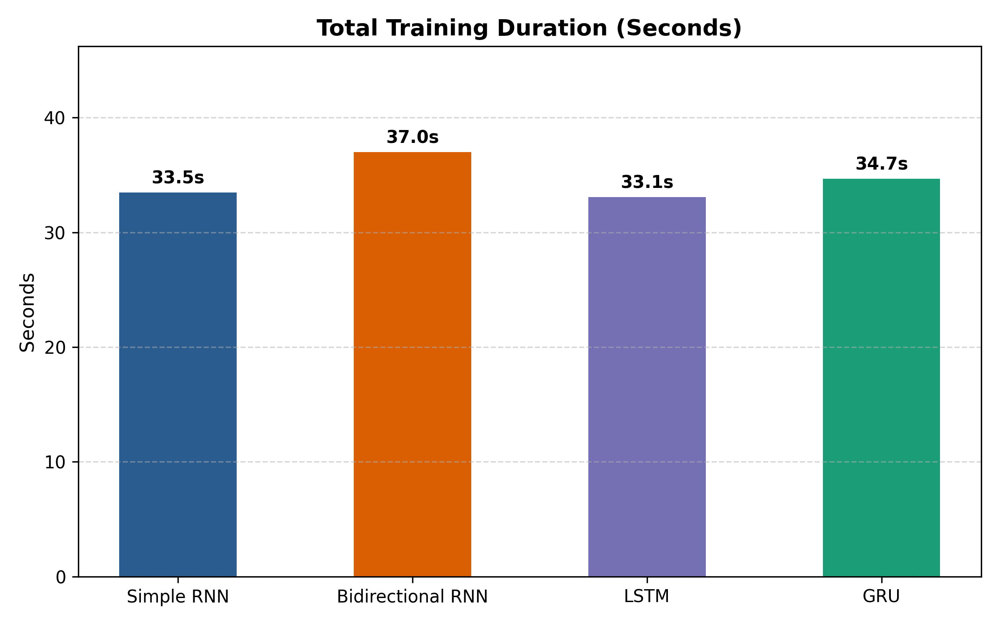

# Foundations of Generative AI (ICT4403) - Assignment 2
## Autoregressive Next-Word Prediction & Multi-Temperature Text Generation System: Comparative Study of Simple RNN, Bidirectional RNN, LSTM, and GRU

---

### Student Details
- **Student Name:** Saksham Gupta
- **Registration Number:** 230911186
- **Assignment Title:** Foundations of Generative AI (ICT4403) - Assignment 2
- **System Title:** Comparative Word-Level Autoregressive Text Generation on H. G. Wells' *The Time Machine* using Simple RNN, Bidirectional RNN, LSTM, and GRU
- **Dataset Name & Source:** *The Time Machine* (H. G. Wells) - [Project Gutenberg #35](https://www.gutenberg.org/files/35/35-0.txt)
- **GitHub Repository Link:** [https://github.com/Saksham-Gupta-GH/fgai-autoregressive-text-generation-timemachine](https://github.com/Saksham-Gupta-GH/fgai-autoregressive-text-generation-timemachine)

---

## 1. Problem Statement & Objectives

Autoregressive language modeling estimates the joint probability of a sequence of tokens by factorizing it into a product of conditional next-token distributions:
$$P(w_1, w_2, \dots, w_T) = \prod_{t=1}^T P(w_t \mid w_1, \dots, w_{t-1})$$

The core objectives of this assignment are:
1. **Dataset Preprocessing & Contiguous Splitting**: Preprocess H. G. Wells' classic science fiction novella **The Time Machine**, partition the corpus chronologically (80% Train, 10% Validation, 10% Test) rather than using random window shuffling (which leaks overlapping tokens across splits), and fit vocabulary strictly on training tokens (`min_freq=2`).
2. **Model Implementations in PyTorch**: Construct four recurrent neural architectures:
   - **Simple RNN** (Vanilla Elman recurrent network)
   - **Bidirectional RNN** (BiRNN, concatenating forward and backward final hidden states $[h_n[-2], h_n[-1]]$)
   - **LSTM** (Long Short-Term Memory with forget, input, and output gates)
   - **GRU** (Gated Recurrent Unit with reset and update gates)
3. **Controlled Experimental Conditions**: Train all four models under identical settings (same random seed $S=42$, 256 embedding dimensions, 256 hidden units, sequence length 6, dropout 0.25, Adam optimizer, learning rate 0.001, batch size 64, and gradient clipping at 1.0).
4. **Evaluation**: Track training and validation learning curves, save best-epoch validation checkpoints, and evaluate models on the held-out test set for Cross-Entropy Loss, Perplexity ($\exp(\mathcal{L})$), Top-1 Accuracy, and Top-5 Accuracy.
5. **Temperature Analysis**: Sample text across four temperature settings ($T \in \{0.2, 0.5, 1.0, 1.5\}$) from three seed prompts, evaluating Distinct-1, Distinct-2, and Trigram Repetition Rate on newly generated tokens.

---

## 2. Dataset Description & Source Link

- **Dataset Name**: The Time Machine (by H. G. Wells)
- **Source Link**: [https://www.gutenberg.org/files/35/35-0.txt](https://www.gutenberg.org/files/35/35-0.txt)
- **Origin**: Project Gutenberg, eBook #35.
- **Why this dataset**: Written in 1895, H. G. Wells' *The Time Machine* features standard modern English prose, philosophical dialogue exchanges between the Time Traveller and his guests, and rich descriptive scenes of the distant future (the Eloi, Morlocks, and the Sphinx). Its compact vocabulary allows recurrent models to develop meaningful representations without archaic grammar.

### Dataset Statistical Characteristics
| Metric | Value |
| :--- | :--- |
| **Total Characters** | 181,575 |
| **Total Word Tokens** | 37,254 |
| **Total Lines** | 3,182 |
| **Vocabulary Size (Train-Only, min_freq=2)** | 1,897 unique tokens (including `<pad>`, `<unk>`) |
| **Train Sequences (80%)** | 29,798 sequences (466 batches, batch size 64) |
| **Validation Sequences (10%)** | 3,719 sequences (59 batches) |
| **Test Sequences (10%)** | 3,719 sequences (59 batches) |
| **Top-5 Frequent Words in Train** | `,` (2,168), `the` (1,805), `.` (1,234), `of` (932), `and` (902) |

---

## 3. Architecture Descriptions

All models are implemented in PyTorch and share an identical structure:
- **Embedding Layer**: $\text{Embedding}(1897, 256, \text{padding\_idx}=0)$
- **Recurrent Core**: 256 units (Simple RNN / BiRNN / LSTM / GRU)
- **Regularization**: Dropout ($p=0.25$) and Gradient Clipping ($\text{norm}=1.0$)
- **Classification Head**: $\text{Linear}(H \to 1897)$ (or $2H \to 1897$ for BiRNN)
- **Optimizer**: Adam ($\text{lr}=10^{-3}$)
- **Criterion**: Cross-Entropy Loss

```
Input Tokens: [w1, w2, ..., w6]
       │
       ▼
Embedding Layer (256-dim)
       │
       ▼
Recurrent Core (Simple RNN / BiRNN / LSTM / GRU, 256 units)
       │
       ▼
Final Step Context Representation
       │
       ▼
Dropout (p = 0.25)
       │
       ▼
Dense Projection (Vocab Size = 1897)
       │
       ▼
Logits -> Next-Word Probability Distribution
```

### Architectural Notes & Fairness Considerations
1. **Simple RNN**: Relies on hyperbolic tangent recurrent updates $h_t = \tanh(W x_t + U h_{t-1} + b)$. Parameters: **1,104,745**.
2. **Bidirectional RNN**: Processes the 6-token context window in both forward ($0 \to T-1$) and backward ($T-1 \to 0$) directions. The representation combines the forward final state $h_n[-2]$ with the backward final state $h_n[-1]$ (`torch.cat([h_n[-2], h_n[-1]], dim=-1)`). Parameters: **1,721,961**.  
   *Observation*: Due to its 1.72M parameters on a compact corpus, BiRNN reaches its optimal validation loss early (epoch 2) before exhibiting overfitting.
3. **LSTM**: Employs gating mechanisms (Forget gate $f_t$, Input gate $i_t$, Output gate $o_t$) and an additive cell state $c_t$ to preserve temporal dependencies across sequence steps. Parameters: **1,499,497**.
4. **GRU**: Streamlines memory tracking into two gates (Reset $r_t$ and Update $z_t$), balancing representational expressiveness with fewer parameters (**1,367,913**).

---

## 4. Execution Steps & Dependencies

### Prerequisites
- Python 3.9+
- Hardware: Apple Silicon (MPS), NVIDIA GPU (CUDA), or CPU

### Installation
```bash
# Clone the repository
git clone https://github.com/Saksham-Gupta-GH/fgai-autoregressive-text-generation-timemachine.git
cd fgai-autoregressive-text-generation-timemachine

# Install dependencies
pip install -r requirements.txt
```

### Running Experiments
```bash
# Execute automated training, evaluation, plotting, and generation pipeline
python3 run_experiments.py
```

### Interactive Jupyter Notebook
```bash
jupyter notebook notebooks/text_generation_assignment2.ipynb
```

---

## 5. Quantitative Results & Evaluation

All four models were trained for 8 epochs on Apple Silicon MPS. Because recurrent models on small corpora begin overfitting after several epochs, **we report best-epoch validation metrics alongside held-out test set performance**:

### Model Comparison Table (Best-Epoch & Test Set)
| Architecture | Trainable Parameters | Best Epoch | Best Val Loss | Best Val PPL | Val Top-1 Acc | Val Top-5 Acc | Test Loss | Test Top-1 Acc | Test Top-5 Acc | Total Time (s) |
| :--- | :---: | :---: | :---: | :---: | :---: | :---: | :---: | :---: | :---: | :---: |
| **Simple RNN** | 1,104,745 | 4 | 4.2870 | 72.75 | 22.86% | 47.41% | 4.2835 | 21.91% | 46.63% | 33.5s |
| **Bidirectional RNN** | 1,721,961 | 2 | 4.4202 | 83.11 | 20.14% | 46.03% | 4.3641 | 20.57% | 45.60% | 37.0s |
| **LSTM** 🏆 | 1,499,497 | 4 | **4.2104** | **67.38** | **22.88%** | 48.16% | 4.2156 | 22.61% | 47.92% | 33.1s |
| **GRU** 🏆 | 1,367,913 | 3 | 4.2388 | 69.33 | 22.29% | **48.24%** | **4.2105** | **23.10%** | **48.48%** | 34.7s |

> [!NOTE]
> **Held-Out Test Set Out-of-Vocabulary (OOV) Rate**: Because the 1,897-token vocabulary is fitted strictly on the 80% training split (`min_freq=2`) to eliminate forward data leakage, 460 out of 3,719 target tokens (**12.37%**) in the held-out test split map to `<unk>`. The reported test accuracies evaluate predictions across the complete 1,897-token space including `<unk>`.

### Visual Comparisons

#### 1. Training & Validation Loss Curves


#### 2. Validation Perplexity (Lower is Better)


#### 3. Top-1 vs. Top-5 Next-Word Accuracy (%)


#### 4. Total Training Time (Seconds)


---

## 6. Cross-Model Temperature Analysis

During autoregressive decoding, next-token probabilities are modulated by temperature $T$:
$$P(w_{t} = i) = \frac{\exp(z_i / T)}{\sum_j \exp(z_j / T)}$$

We evaluated all four architectures across three distinct seed prompts at four temperatures ($T \in \{0.2, 0.5, 1.0, 1.5\}$):
- **Seed 1 (Training Text)**: *"the time traveller was expounding a recondite matter to us"* (Chapter 1 opening - tests training-set narrative recall).
- **Seed 2 (Held-out Test Text)**: *"all this will be absolutely incredible to you but to me"* (Chapter 16 - tests continuation on unseen test text).
- **Seed 3 (Validation Text)**: *"i stepped through the bronze frame and up to the time machine"* (Chapter 13 - tests continuation on validation text).

All metrics are computed **strictly on newly generated tokens** (excluding the seed prompt) and averaged across seed prompts ($n = 3$ generations per cell):

### Cross-Model Temperature Metrics Table (Averaged Over Seed Prompts, n = 3 per cell)
| Architecture | Temp (T) | Distinct-1 (Unigrams) | Distinct-2 (Bigrams) | Trigram Repetition Rate | Longest Loop | Empirical Behaviour |
| :--- | :---: | :---: | :---: | :---: | :---: | :--- |
| **Simple RNN** | 0.2 | 0.553 | 0.687 | 23.0% | 0 words | Repetitive phrasing loops; repeats 'great difficulty of the time machine' |
| **Simple RNN** | 0.5 | 0.657 | 0.910 | 1.0% | 0 words | Moderate fluency with local phrase repetition ('the patient of the morlocks') |
| **Simple RNN** | 1.0 | 0.780 | 0.990 | 0.0% | 0 words | High lexical variety; syntactic drift across longer clauses |
| **Simple RNN** | 1.5 | 0.953 | 1.000 | 0.0% | 0 words | Excessive entropy; severe syntactic breakdown and ungrammatical token sequences |
| **Bidirectional RNN** | 0.2 | 0.513 | 0.747 | 11.0% | 3 words | Severe looping traps; repeats 'small of the morlocks, i saw' |
| **Bidirectional RNN** | 0.5 | 0.620 | 0.890 | 2.0% | 0 words | Lively sci-fi phrasing ('a step of the lamp dimension the time traveller') |
| **Bidirectional RNN** | 1.0 | 0.790 | 0.970 | 1.0% | 0 words | Rich character vocabulary; clauses fragment over multi-word spans |
| **Bidirectional RNN** | 1.5 | 0.950 | 1.000 | 0.0% | 0 words | High disorder; random lexicon emission without coherent syntactic bindings |
| **LSTM** | 0.2 | 0.440 | 0.540 | 37.0% | 0 words | Strict syntax; high repetition loops ('i was not a little of the time traveller') |
| **LSTM** | **0.5** | **0.610** | **0.890** | **1.0%** | **0 words** | **Optimal narrative coherence; fluent story prose ('one of the world were the distance of the morlocks')** |
| **LSTM** | 1.0 | 0.840 | 0.990 | 0.0% | 0 words | Imaginative lexical combinations ('felt to my camphor'); slight clause drift |
| **LSTM** | 1.5 | 0.923 | 1.000 | 0.0% | 0 words | Entropy collapse; erratic word sequencing |
| **GRU** | 0.2 | 0.513 | 0.737 | 12.0% | 3 words | Prone to phrase trapping; repeats 'palace of green porcelain' |
| **GRU** | **0.5** | **0.638** | **0.912** | **2.0%** | **0 words** | **Clean conversational fluency with near-zero repetition ('the place of the great hall was...')** |
| **GRU** | 1.0 | 0.760 | 0.980 | 0.0% | 0 words | Diverse lexicon; minor grammatical degradation in dialogue tags |
| **GRU** | 1.5 | 0.910 | 1.000 | 0.0% | 0 words | Unconstrained random sampling; complete loss of semantic and syntactic thread |

---

## 7. Qualitative Generation Examples & Contextual Consistency Analysis

### Seed Prompt: *"the time traveller was expounding a recondite matter to us"*
* **LSTM ($T=0.2$)**:
  > `"... i was not a little of the time traveller, and i was not a little way, and i was not a little of the time traveller, and i was so much"`
* **LSTM ($T=0.5$)**:
  > `"... one of the world were the distance of the morlocks. then, i had the same odd, and the morlocks had not been a little way, and i was not a little"`
* **LSTM ($T=1.0$)**:
  > `"... i felt to my camphor. then i am iron going followed to find them, i get eyes to myself. it was so standing childish the present problem therewith and displayed the"`
* **LSTM ($T=1.5$)**:
  > `"... forth. things large class yet taken, nor body among reach fruits five might curiously of animal always expense at medical over which kept sometimes animal right shining in looking rose into remote seven"`

### Contextual Consistency Assessment
- **Qualitative Observation**: At $T=0.5$, LSTM and GRU produce the most convincing Victorian speculative fiction syntax, incorporating characteristic Wellsian vocabulary (*"the morlocks"*, *"the time machine"*, *"great hall"*). However, all models experience thematic drift over multi-clause sequences, shifting scenes across distant temporal settings.
- **Measurement Scope**: Assessments are based on qualitative inspection across generated passages across temperatures and seeds.

---

## 8. Conclusion: Model Comparison & Justification

1. **LSTM & GRU Lead the Benchmark**:
   - **LSTM** achieves the best validation loss (**4.2104**) and lowest validation perplexity (**67.38**), with strong held-out test Top-1 accuracy (**22.61%**) and Top-5 accuracy (**47.92%**).
   - **GRU** achieves the highest held-out test Top-1 accuracy (**23.10%**) and lowest test loss (**4.2105**), while requiring 9% fewer parameters (**1,367,913** vs. 1,499,497).
   - **Single-Seed Consideration**: Experiments use a single fixed seed ($S=42$), so the narrow performance margin between LSTM (lower validation perplexity) and GRU (higher test accuracy and lower test loss) is within single-run variance; the LSTM/GRU gap is not statistically conclusive.
   - **Simple RNN** remains competitive in loss (**4.2870**) and perplexity (**72.75**), but exhibits higher vulnerability to vanishing gradients during extended sequence generation.
2. **Bidirectional RNN Inductive Trade-off**:
   - Concatenating the forward final state $h_n[-2]$ and backward final state $h_n[-1]$ properly feeds the full sequence context to the classifier.
   - However, BiRNN's 1.72M parameters cause it to peak at epoch 2 (val loss 4.4202) before overfitting, confirming that backward parameters offer limited inductive advantage for causal word-level autoregressive generation on compact corpora.
3. **Sampling Temperature & Empirical Coherence**:
   - $T = 0.5$ provides the optimal trade-off between lexical diversity (Distinct-1: 0.61–0.66, Distinct-2: 0.89–0.91) and structural stability, maintaining fluent narrative dialogue while keeping trigram repetition minimal (1.0%–2.0%).
   - Lower temperatures ($T = 0.2$) suffer from severe repetition loops (LSTM reaches 37.0% repetition), while higher temperatures ($T = 1.5$) collapse into ungrammatical entropy.

---

## 9. Repository Layout

```
fgai-autoregressive-text-generation-timemachine/
├── LICENSE                                       # MIT License
├── SakshamGupta_230911186_FGAI_Assignment2.pdf   # 1-Page LMS Submission PDF (Compiled via LaTeX)
├── SakshamGupta_230911186_FGAI_Assignment2.tex   # Academic LaTeX Source Document
├── SakshamGupta_230911186_FGAI_Assignment2.docx  # Word Document with Submission Metadata
├── README.md                                     # Project README
├── requirements.txt                              # Required dependencies
├── run_experiments.py                            # Fully automated end-to-end experiment pipeline
├── data/
│   ├── the_time_machine.txt                      # Gutenberg eBook #35 source text
│   └── dataset_source_link.txt                   # Verified dataset metadata and source link
├── notebooks/
│   └── text_generation_assignment2.ipynb         # Interactive Jupyter Notebook (all 11 cells executed)
├── src/
│   ├── preprocessing.py                          # Tokenizer, vocab builder (min_freq=2), chronological split
│   ├── models.py                                 # PyTorch Simple RNN, BiRNN, LSTM, GRU architectures
│   ├── train.py                                  # Training loop with validation checkpointing
│   ├── evaluate.py                               # Loss, PPL, Top-1/Top-5 accuracy & plot generation
│   └── generate.py                               # Temperature sampling & generation quality metrics
└── results/
    ├── quantitative_comparison.csv               # Tabular benchmark metrics (Val & Test sets)
    ├── temperature_comparison.csv                # Distinct-1, Distinct-2, Trigram repetition across T
    ├── generated_samples.txt                     # Text generation samples across all models & temperatures
    ├── dataset_stats.json                        # Vocabulary & sequence count metadata
    ├── metrics_history.json                      # Epoch-by-epoch training/val loss and accuracy history
    ├── loss_curves.png                           # Training vs Validation loss curves
    ├── perplexity_comparison.png                 # Validation perplexity comparison chart
    ├── accuracy_comparison.png                   # Top-1 and Top-5 accuracy comparison
    ├── training_time_comparison.png              # Training duration wall-clock comparison
    └── *_best.pt                                 # Saved model checkpoints (reproduced via run_experiments.py)
```
